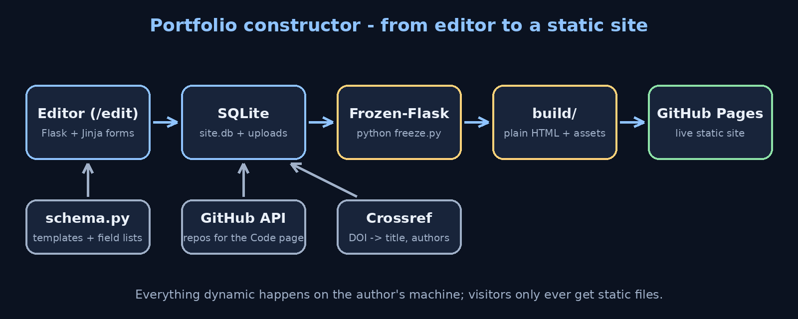

# Portfolio Constructor

A small Flask app for building and maintaining a personal / research portfolio. You fill in forms in a local
editor; it publishes a **fully static site** that can be hosted for free on GitHub Pages.



## Features

- **Projects and publications** with three templates - *HCI & AR-VR*, *Tech for AR-VR*, *Educational Technology*.
  Forms and detail pages are generated from one file, `schema.py`; extra fields live in a JSON column, so adding a
  field needs no database migration.
- **Publications by DOI** - paste a DOI and the title, authors and year are filled in from Crossref.
- **Scholastics, skills, certifications** (PDF / image certificates open in an on-site viewer), **conferences**
  (several roles per conference), **writing**, and **indie projects**.
- **Code page** - syncs your repositories from GitHub, then lets you hide, pin, rename, describe and categorise them.
  Visitors get category filters, a tech-stack filter ("built with ..."), search and a README preview.
- **At a Glance pages** made with a visual page builder.
- **Static output** - `python freeze.py` renders every public page to `build/`.

## Getting started

```bash
git clone https://github.com/<your-username>/portfolio-constructor.git
cd portfolio-constructor

python -m venv .venv
source .venv/bin/activate            # Windows (Git Bash): source .venv/Scripts/activate
pip install -r requirements.txt

cp .env.example .env                 # then put a random SECRET_KEY in it
python app.py                        # editor + preview: http://127.0.0.1:5000/edit
```

The database (`instance/site.db`) and your uploads (`static/uploads/`) are created on your machine and are
**git-ignored** - they are your content, not part of this repository. A new database starts empty: add your
details (name, photo, links, footer) in the editor first.

## Publish

```bash
python freeze.py                     # writes the static site to ./build
```

Copy the contents of `build/` into your `<username>.github.io` repository (or any static host) and push it.

## Important: the editor has no login

`/edit` and the other editor routes are meant to run **on your own computer only**. Never deploy this app to a
public server - only the frozen `build/` output is meant to be public.

## Project layout

| Path | What it is |
|------|------------|
| `app.py` | Flask routes (public pages and editor endpoints) |
| `database.py` | SQLite tables, loaders / savers, GitHub and Crossref helpers |
| `schema.py` | Field lists of the three project / publication templates |
| `freeze.py` | Frozen-Flask build script |
| `templates/`, `static/` | Jinja pages and the site's CSS / JS / theme images |

## Credits

The visual theme builds on a Bootstrap landing-page template (TechStart Pro); the page flip, PDF viewer and slider
come from `page-flip`, `pdf.js` and `slick`, each under its own licence (see `static/`). Check the theme's licence
before reusing it for anything beyond a personal site.

## Licence

MIT - see [LICENSE](LICENSE). Replace `[YOUR NAME]` in the licence with your name before publishing.
# Portfolio_Constructor
